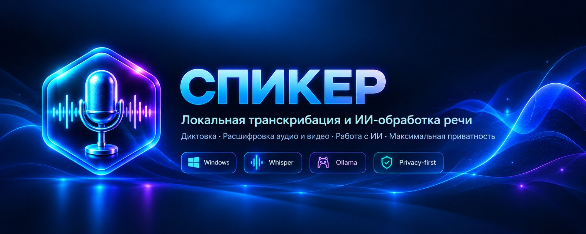
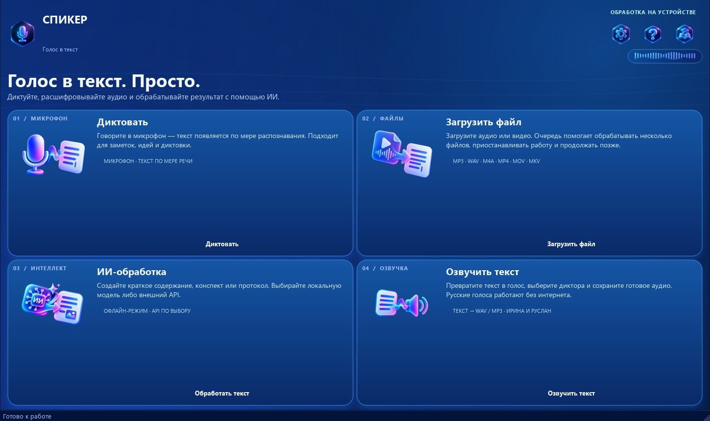
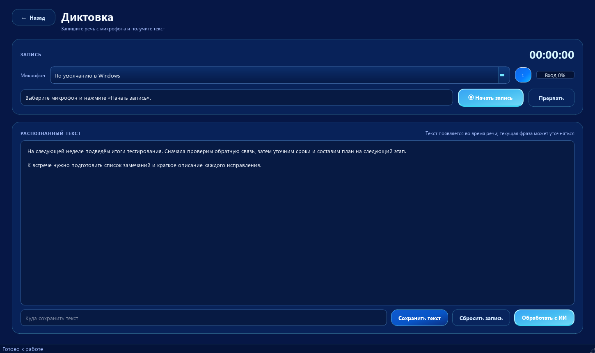
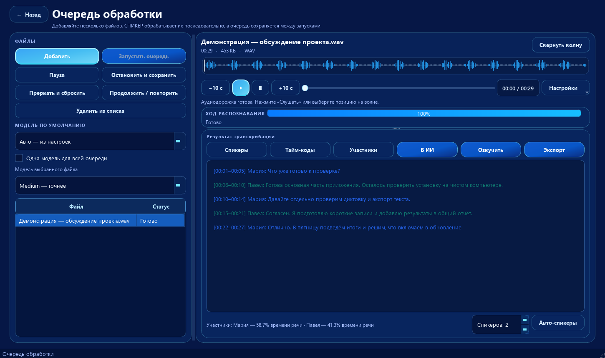
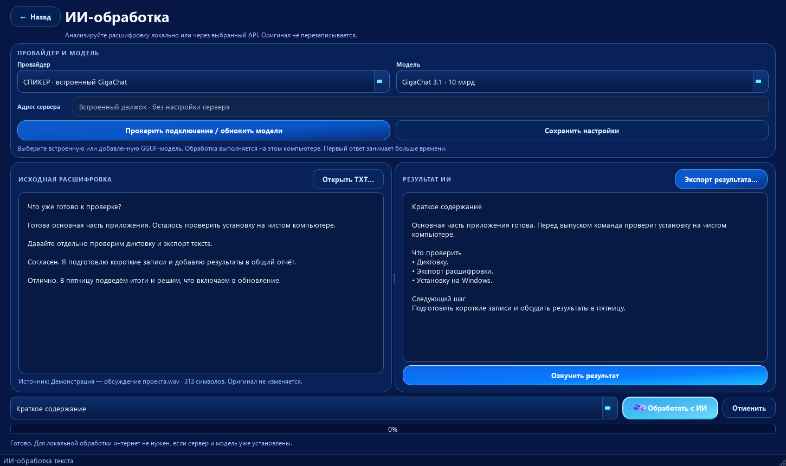
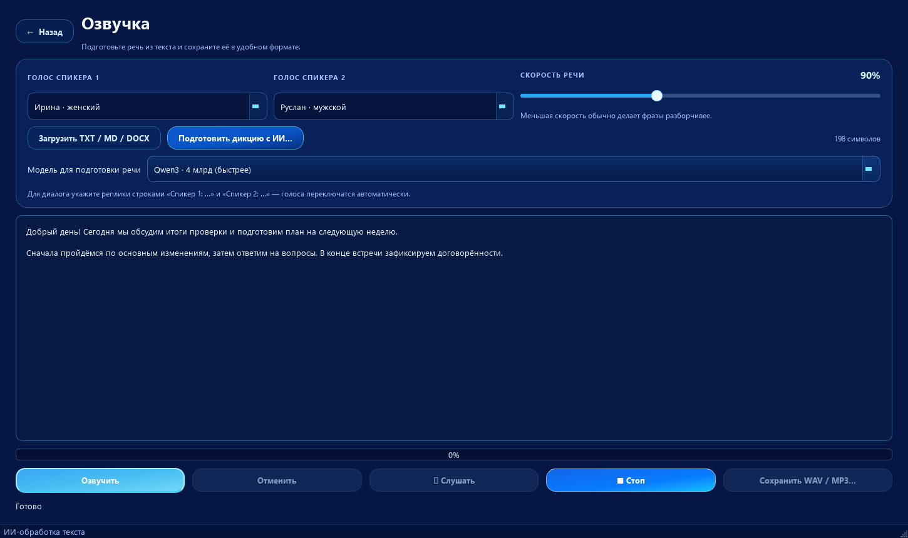
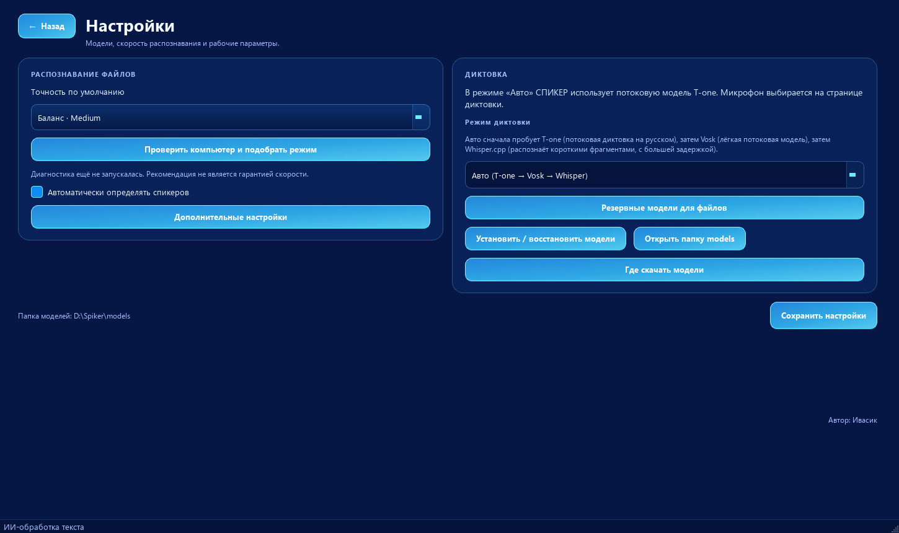
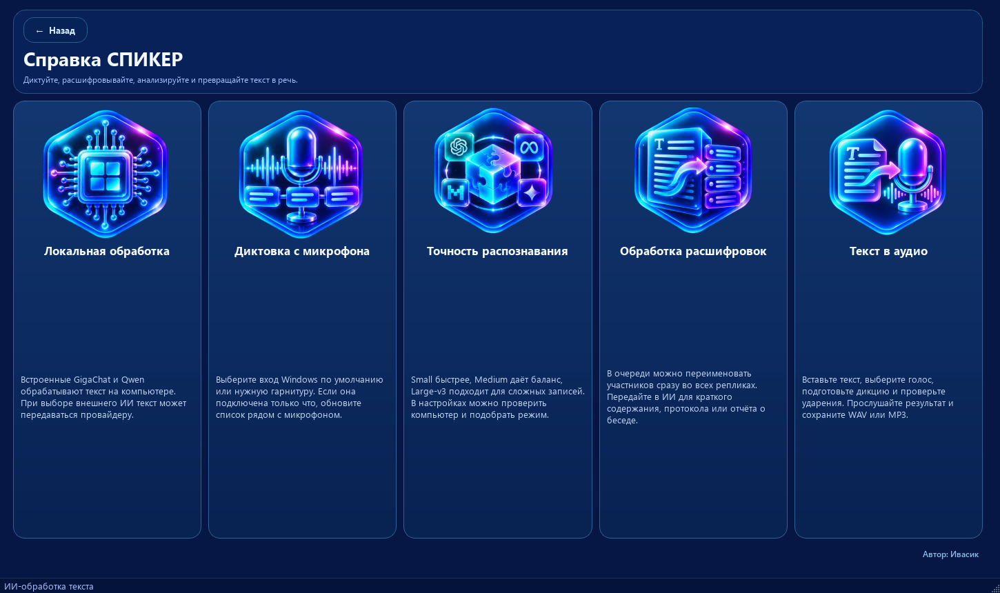
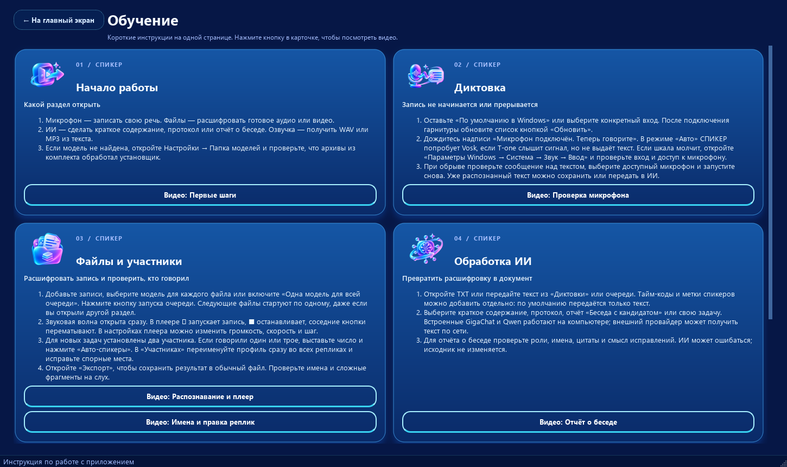

# СПИКЕР 3.1.5 — диктовка, расшифровка и озвучка

[Скачать для Windows](https://github.com/MarcoPolo54321/Spiker/releases/tag/v3.1.4-refresh) · [Скриншоты](#скриншоты) · [English](README_EN.md)

СПИКЕР распознаёт речь с микрофона и из аудио или видео, помогает редактировать расшифровки и озвучивать тексты. В локальном режиме для обработки не нужен внешний сервис.

## Установка

1. Для Windows 10/11 x64 скачайте [установщик СПИКЕР 3.1.5](https://github.com/MarcoPolo54321/Spiker/releases/tag/v3.1.5) и [совместимый архив моделей распознавания](https://github.com/MarcoPolo54321/Spiker/releases/download/v3.1.4-refresh/Spiker-Models-3.1.4-Windows.zip).
2. Положите оба файла рядом. Запустите установщик. Он проверит архив и распакует модели; вручную распаковывать ZIP не нужно.
3. Откройте «СПИКЕР» из меню «Пуск». При необходимости добавьте [модели голосов, участников или локального ИИ](#дополнительные-модели).

Базовый архив включает Whisper Small для файлов, T-one для потоковой диктовки и резервный Vosk. На ПК, где модели уже установлены, этот же EXE обновляет приложение поверх существующей папки.

## Что обновилось

- При первом открытии очереди больше не всплывают отдельные окна. Добавленный файл ждёт ручного запуска; после запуска очередь переходит к следующему файлу автоматически. У каждого файла можно выбрать свою модель или использовать общую. Волна открыта по умолчанию.
- Диктовка использует системный микрофон Windows и показывает текст по мере распознавания.
- При переносе в ИИ по умолчанию передаётся только текст. Тайм-коды и подписи участников можно включить отдельно. Есть режимы краткого содержания, протокола и отчёта по беседе с кандидатом.
- Озвучка сохраняется в WAV или MP3. В диалоге участникам можно назначить разные голоса. Для подготовки дикции доступны установленные локальные модели.
- Обучение получило новые карточки и полноэкранный плеер. Приложение открывается без PIN-кода; новые записи сохраняются в «Документы → Spiker» обычными файлами.

## Дополнительные модели

Откройте «Настройки → Где скачать модели». Устанавливайте модели в папку `models` рядом с `Spiker.exe`. Веса необязательных моделей загружаются из исходных каталогов:

- **Распознавание файлов:** [Whisper Medium](https://huggingface.co/Systran/faster-whisper-medium) и [Large-v3](https://huggingface.co/Systran/faster-whisper-large-v3). Сохраните `config.json`, `model.bin`, `tokenizer.json` и словарь в `models/faster-whisper/medium` или `models/faster-whisper/large-v3`.
- **Озвучка:** [Ирина](https://github.com/k2-fsa/sherpa-onnx/releases/download/tts-models/vits-piper-ru_RU-irina-medium.tar.bz2) и [Руслан](https://github.com/k2-fsa/sherpa-onnx/releases/download/tts-models/vits-piper-ru_RU-ruslan-medium.tar.bz2). Распакуйте папки целиком в `models/tts` и перезапустите программу.
- **Участники записи:** [архив сегментации](https://github.com/k2-fsa/sherpa-onnx/releases/download/speaker-segmentation-models/sherpa-onnx-pyannote-segmentation-3-0.tar.bz2) распакуйте в `models/diarization`. В ту же папку сохраните [модель голосовых признаков WeSpeaker](https://github.com/k2-fsa/sherpa-onnx/releases/download/speaker-recongition-models/wespeaker_en_voxceleb_resnet34.onnx). В очереди можно задать число участников вручную и отредактировать их имена.
- **Локальный ИИ:** [Qwen3 4B](https://huggingface.co/Qwen/Qwen3-4B-GGUF) или [GigaChat 10B](https://huggingface.co/ai-sage/GigaChat3.1-10B-A1.8B-GGUF). Поместите файл `.gguf` в `models/llm` и выберите модель в «ИИ-обработке». Для внешнего API действует [отдельный порядок передачи данных](docs/PRIVACY.md).

## Скриншоты

| Главное меню | Диктовка |
| --- | --- |
|  |  |
| **Очередь обработки** | **ИИ-обработка** |
|  |  |
| **Озвучка** | **Настройки** |
|  |  |
| **Справка** | **Обучение** |
|  |  |

[Полноэкранный видеопример](assets/screenshots/learning-video.png)

[История изменений](RELEASE_NOTES.md) · [Сборка Windows](docs/BUILD_WINDOWS.md) · [Публикация](docs/PUBLISHING.md) · [Android: отдельные исходники](docs/ANDROID_BUILD_RU.md)

[Архитектура и дорожная карта](docs/ARCHITECTURE_AND_ROADMAP_3.1.0.md). У предыдущих выпусков установщики могли называться `Spiker-Setup-<версия>.exe`; для Refresh используйте пару файлов из раздела «Установка».

**Своя Ollama или LM Studio в локальной сети:** в «ИИ-обработке» укажите LAN-адрес и порт сервера и нажмите «Проверить подключение». Для Ollama на соседнем ПК нужно включить доступ из LAN и открыть порт в брандмауэре. [Пошаговая настройка](docs/LOCAL_AI_LAN_RU.md).

## Разработка и сопровождение

Правила изменений, проверок, безопасности и выпуска находятся в [руководстве по управлению изменениями](docs/CHANGE_MANAGEMENT.md). Краткий порядок — [рабочий процесс](docs/workflow.md); карта кода и принятые решения — в [архитектуре](docs/architecture.md) и [реестре решений](docs/decisions.md).
