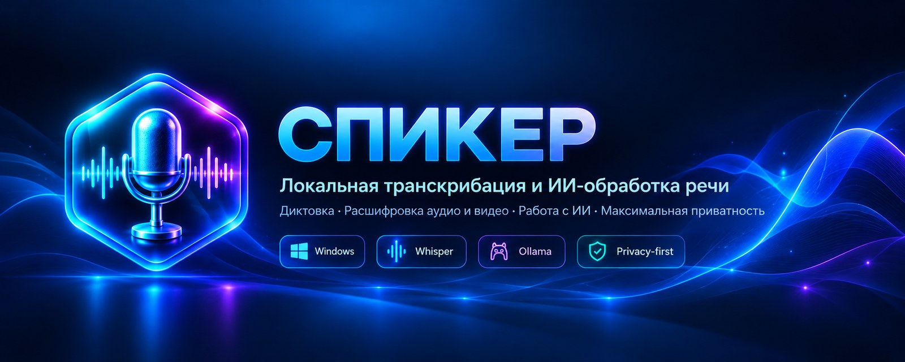
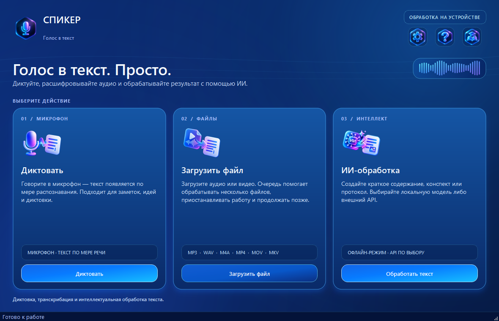
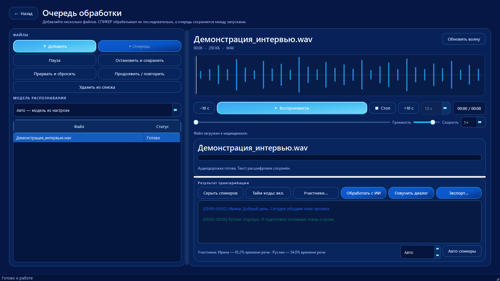
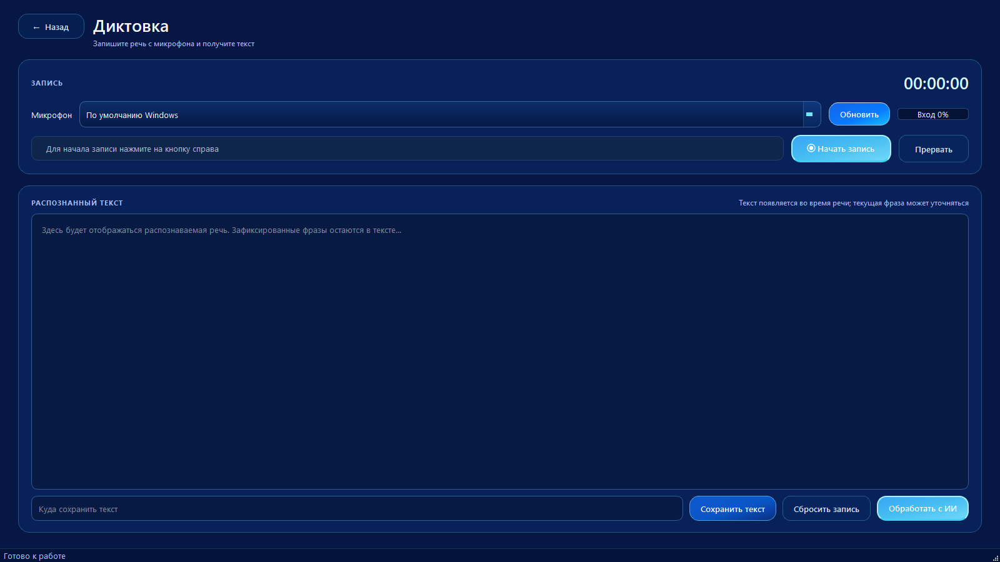
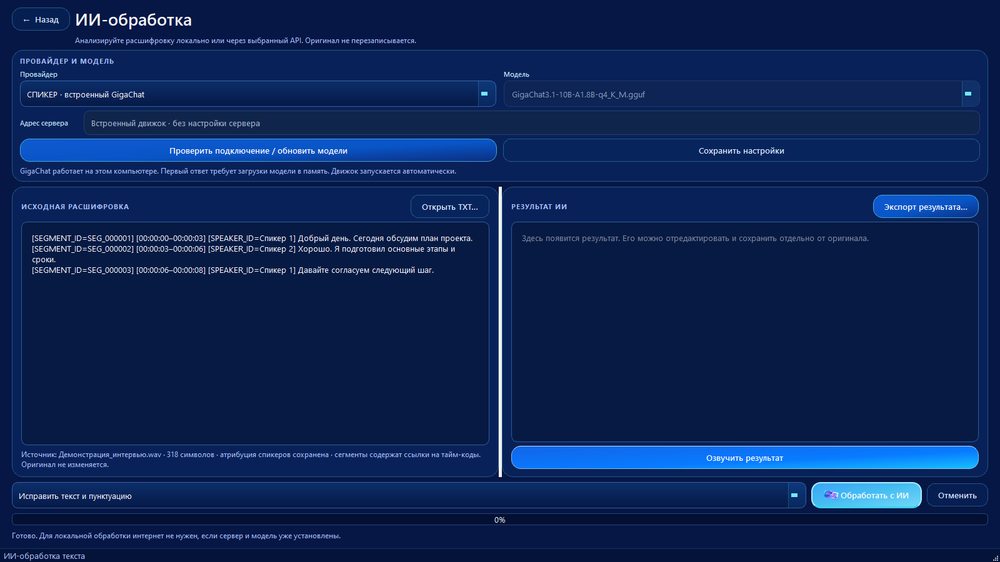
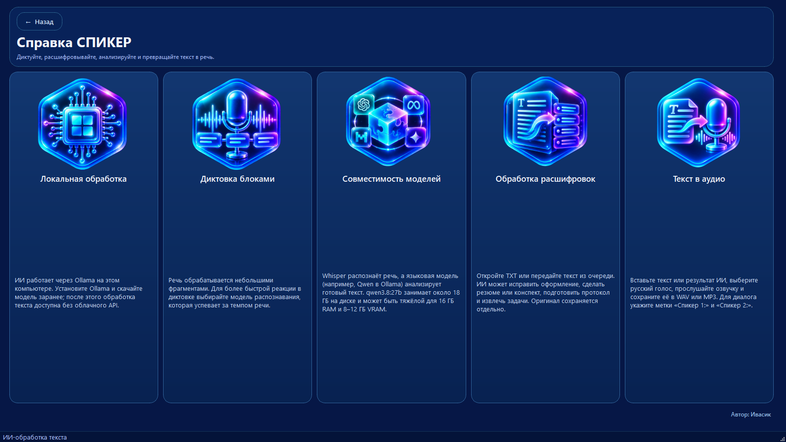

# СПИКЕР 3.1.3 — релиз для GitHub и Windows

3.1.3 уплотняет главный экран при уменьшении окна, открывает программу на весь доступный экран и выделяет кнопки основного меню более ярким синим оттенком.

3.1.2 унифицирует синюю тему, закрепляет SHA-256 моделей и сборочных компонентов, безопасно распаковывает архивы и останавливает активный сетевой запрос ИИ при отмене.

3.1.0 добавляет автоматическое разделение по голосу, отдельный раздел «Озвучка», Whisper Medium, встроенный локальный GigaChat, выбор микрофона и приватную папку данных в «Документы\\Spiker». Android-проект использует ту же синюю тему и локальные модели для диктовки, синтеза речи и разделения участников.

**Windows build:** `Build_Spiker_Windows_Installer.bat` создаёт Setup.exe и Portable ZIP отдельно от моделей. Полная версия использует базовый `Spiker-Models-<версия>.zip` и отдельный архив `Spiker-Models-Medium-<версия>.zip`, чтобы каждый файл помещался в лимиты GitHub Releases. Setup разложит оба ZIP автоматически; Portable установит их при первом старте, если они лежат рядом с папкой приложения. `Build_Spiker_Windows_Basic.bat` создаёт компактную версию с одним архивом моделей. GitHub Actions собирает оба профиля. Для конечных пользователей есть [короткая инструкция установки](INSTALL_WINDOWS_RU.txt).

Для ручной загрузки полной версии используйте `Spiker-Setup-<версия>.exe`, `Spiker-Models-<версия>.zip` и `Spiker-Models-Medium-<версия>.zip`. Компактному профилю соответствуют `Spiker-Setup-<версия>-Basic.exe`, `Spiker-Portable-<версия>-Basic.zip` и `Spiker-Models-<версия>-Basic.zip`.

Подробности: [RELEASE_NOTES.md](RELEASE_NOTES.md) · [сборка Windows](docs/BUILD_WINDOWS.md) · [публикация GitHub](docs/PUBLISHING.md) · [модели](docs/MODELS.md) · [архитектура и план до 3.4](docs/ARCHITECTURE_AND_ROADMAP_3.1.0.md) · [план испытаний](docs/TEST_PLAN_3.1.0.md) · [Android](docs/ANDROID_BUILD_RU.md).

<div align="center">

  
  <p><a href="README_EN.md">English version</a></p>
</div>

<div align="center">

# СПИКЕР — голос в текст. Просто.

**Говорите, записывайте, расшифровывайте — остальное СПИКЕР поможет сделать проще.**

Настольное приложение для Windows: диктовка, расшифровка аудио и видео, плеер и ИИ-обработка готовых текстов.

[Скачать для Windows](#установка) · [Скриншоты](#скриншоты) · [Конфиденциальность](docs/PRIVACY.md) · Сообщить об ошибке — раздел Issues репозитория

Порядок загрузки исходников и публикации сборок: [инструкция для GitHub](GITHUB_UPLOAD_RU.txt).

</div>

СПИКЕР объединяет несколько задач в одном приложении: быстро записать идею, расшифровать длинную запись, прослушать нужный фрагмент и превратить текст в конспект, краткое содержание или протокол встречи. Для диаризации можно задать точное число участников, если оно известно.

**Меньше рутины — больше времени на то, что действительно важно.**

### Дополнительные исправления интерфейса (3.0.7.5–3.0.7.6)

- Устранён серый фон `QTextBrowser` на вкладках обучения: его внутренний viewport и палитра теперь прозрачны, а содержимое расположено на полупрозрачной синей панели в общей цветовой теме СПИКЕР.
- Фон самой страницы обучения и области вкладок не перекрывает фон приложения; вкладки руководства оформлены в той же сине-голубой палитре.
- Добавлен отдельный запускатель `Build_Spiker_Windows_Installer.bat`: двойной щелчок запускает сборку Windows Setup (`Spiker-Setup-3.1.1.exe`) и portable ZIP в папке `dist`.
- Сборщик надёжнее находит Python 3.11 x64 через Windows Python Launcher `py -3.11`, даже если на PATH установлена другая версия Python. Inno Setup 6 автоматически обнаруживается или предлагается к установке через WinGet.

### Исправления интерфейса и управления (3.0.7.4–3.1.0)

- В таблице очереди всегда видны файл и его статус; прогресс, имя, метаданные и результат распределены по изменяемым панелям.
- Расшифровка появляется по мере готовности сегментов, без ожидания остановки или окончания всей записи.
- «Прервать и сбросить» и «Сбросить запись» активно останавливают микрофон/декодер; обычный стоп завершает обработку уже записанного аудио.
- Участников можно создавать и назначать вручную, даже если pyannote не установлена; автоматическая диаризация выполняется отдельно от ИИ.
- Диагностика сохраняет рекомендации, профили применяются одним выбором, а настройки показывают фактически доступные движки и поясняют совместимость моделей.
- В главном меню есть встроенная вкладка «Инструкция по работе с приложением»; пункт «Обучение» расположен рядом со «Справкой» и «Настройками», с отдельной иконкой.
- Иконка карточки «ИИ-обработка» заменена самостоятельным PNG-изображением пользователя.

Подробности — в `RELEASE_NOTES.md`, план проверки исправления обучения и локального Windows-сборщика — `docs/TEST_PLAN_3.1.0.md`.


## Возможности

### Расширенная локальная транскрибация

В настройках доступна диагностика процессора, ОЗУ, NVIDIA GPU/VRAM и CUDA с рекомендацией режима. После диагностики можно принудительно выбрать CPU или CUDA, тип вычислений, модель и размер пакета. Для ускоренного движка предусмотрен faster-whisper/CTranslate2; текущий Whisper.cpp остаётся резервным. Дополнительно доступны VAD, контекстный словарь, словесные временные метки и мягкая нормализация громкости.

Диаризация работает как отдельный необязательный локальный модуль pyannote. После её настройки сегменты получают ID говорящих; в очереди можно скрыть подписи спикеров, переименовать участников, объединить профили и вручную переназначить отдельные реплики; фразы участников выделяются цветом. Сами speaker ID остаются в данных и JSON-экспорте. В ИИ-панели добавлены сводка по каждому участнику и разбор предложений/решений по спикерам. Подробная установка дополнительных компонентов описана в `docs/ADVANCED_TRANSCRIPTION.md`. В исходном ZIP базовые модели устанавливаются через `Install_Models.bat`; GitHub Windows build включает Sherpa-ONNX/T-one и faster-whisper/CTranslate2 runtime.


### 🎙️ Диктовка в реальном времени

Для минимальной задержки доступен отдельный потоковый движок Sherpa-ONNX / T-one: он получает аудио небольшими блоками, показывает меняющуюся гипотезу и фиксирует фразы после паузы. Vosk остаётся потоковым резервом, Whisper — совместимым режимом по коротким окнам. В настройках есть выбор «Авто / Sherpa / Vosk / Whisper». В исходном ZIP T-one устанавливается через `Install_Models.bat` или `Install_Live_Dictation.bat`; в GitHub Windows build Sherpa-ONNX и модель T-one включены в сборку. Подробности — в `docs/LIVE_DICTATION.md`. План ручной проверки релиза — `docs/TEST_PLAN_3.1.0.md`.

### Очередь, редактор и источники
Очередь хранится в SQLite/WAL с импортом прежнего JSON; новые сегменты добавляются инкрементально. Для длинных записей сохраняются сегменты, исходные таймкоды и speaker ID; SQLite обновляет изменённые задачи без полной перезаписи всей очереди. Профили аудио позволяют не отбрасывать вокал VAD и выбирать аудиодорожку в мультидорожечных видео.

### 🎬 Расшифровка аудио и видео

Преобразуйте речь из медиафайлов в текст. Добавляйте несколько файлов в очередь, обрабатывайте их последовательно, приостанавливайте задачу и продолжайте позже.

### 🎧 Работа с аудио

Встроенный проигрыватель позволяет прослушивать запись, перемещаться по звуковой дорожке и находить нужные фрагменты — удобно для проверки длинных расшифровок.

### ✨ ИИ-обработка текста

Создавайте краткое содержание и конспекты, структурируйте информацию, извлекайте задачи и улучшайте оформление расшифровок. Можно выбрать локальную языковую модель или подключить поддерживаемый внешний API.

### 🧠 Гибкая работа с моделями

Для файлового распознавания речи используется Whisper; установщик Windows включает мультиязычную модель Whisper Small. Для потоковой диктовки можно отдельно установить Sherpa-ONNX / T-one или использовать Vosk. Для обработки текста поддерживается подключение к локальным языковым моделям через Ollama.

### 🔒 Контроль над данными

Встроенная транскрибация выполняется локально. При использовании локальной языковой модели текст остаётся на устройстве, если Ollama и модель уже установлены и приложение настроено на локальный режим. Внешний API передаёт текст выбранному провайдеру; перед отправкой проверьте настройки и конфиденциальность исходных данных.

## Скриншоты

### Главное меню



### Очередь транскрибации и плеер



### Диктовка с микрофона



### ИИ-обработка расшифровок



### Справка и совместимость моделей



## Установка

### Запуск из исходного ZIP

1. Распакуйте архив в отдельную папку с правом записи.
2. Установите Python 3.11 x64, если он ещё не установлен.
3. Запустите `Install_Models.bat` для базовых моделей Whisper.cpp, faster-whisper Small, Sherpa-ONNX/T-one и Vosk. Для загрузки моделей потребуется интернет и свободное место.
4. Если нужна авторазбивка по участникам, отдельно запустите `Install_Speaker_Diarization.bat`: примите условия Community-1 на Hugging Face и введите Read-токен. Токен не сохраняется.
5. Запускайте программу через `Launch_Spiker.bat`. Другие BAT-файлы запускаются только для установки/ремонта соответствующих компонентов.

### Для пользователей Windows

1. Откройте раздел **Releases** этого репозитория.
2. Для полной версии скачайте Setup и оба архива моделей `Spiker-Models-<версия>.zip` и `Spiker-Models-Medium-<версия>.zip`; Basic использует один `Spiker-Models-<версия>-Basic.zip`. Положите файлы в одну папку.
3. Запустите установщик и следуйте подсказкам. Он сам разложит модели. Python, Qt и необходимые библиотеки приложения отдельно устанавливать не нужно.
4. Для Portable скачайте соответствующие архивы моделей и положите их рядом с распакованной папкой `Spiker`; при первом запуске программа установит их автоматически.

> Если на странице Releases пока нет `Spiker-Setup-*.exe`, значит Windows-сборка ещё не опубликована. Она создаётся GitHub Actions после отправки версии-тега; см. [инструкцию публикации](docs/PUBLISHING.md).

Если сборщик сообщает об отсутствии `pip` в `.build-venv`, повторно запустите `Build_Spiker_Windows_Installer.bat`: скрипт использует `scripts/bootstrap_build_pip.py`, который восстанавливает pip через `ensurepip`, а при необходимости — официальный bootstrap PyPA. Не удаляйте исходники или папку `models`; сборщик самостоятельно восстановит только повреждённую часть build-окружения.

### Локальная ИИ-обработка текста

По умолчанию доступен встроенный GigaChat (модель ~6.5 ГБ; 16 ГБ ОЗУ достаточно для выбранного q4, первый ответ запускает локальный CPU-движок). Ollama и OpenAI-совместимые провайдеры доступны по желанию. Для Ollama выберите провайдер и установите модель, например:

```powershell
ollama pull qwen2.5:0.5b
```

В приложении выберите «Локальный ИИ · Ollama» и нажмите «Проверить подключение / обновить модели». Модель занимает около 400 МБ. Краткие шаги также есть в [инструкции Windows](INSTALL_WINDOWS_RU.txt).

Чтобы пользоваться локальным ИИ без интернета, установите Ollama и скачайте модель заранее, пока сеть доступна. Языковые модели велики, поэтому они не включены в основной установщик. Внешний API доступен как дополнительный вариант и требует интернета.

Модель `qwen3.8:27b` доступна для выбора в приложении, но занимает около 18 ГБ на диске и может быть непрактична при 16 ГБ ОЗУ и 8–12 ГБ видеопамяти. Подбирайте размер модели под характеристики устройства.

## Для кого предназначен СПИКЕР

- **Работа:** расшифровка встреч, интервью, звонков и обсуждений.
- **Учёба:** конспекты лекций, записи занятий и структурирование материала.
- **Творчество:** голосовые заметки, фиксация идей и подготовка черновиков.
- **Повседневные задачи:** диктовка и быстрое преобразование речи в текст.

## Технологии

- **Python** — основа приложения.
- **Whisper / whisper.cpp** — распознавание речи.
- **Sherpa-ONNX / T-one** — необязательный потоковый движок русской диктовки; **Vosk** — потоковый резервный движок.
- **Ollama** — подключение локальных языковых моделей.
- **PySide6 / Qt** — графический интерфейс.
- **Windows 10/11 x64** — целевая платформа.

## Исправление сборки 3.1.0

Для Windows build добавлены тестовая зависимость Pillow (только для регрессионного теста прозрачности PNG) и восстановление build virtualenv, если `ensurepip` не сработал. Скрипт может создать окружение без pip, затем восстановить pip через `ensurepip` или официальный PyPA bootstrap. Версия берётся из файла `VERSION`; для 3.1.0 Windows file metadata получает номер `3.1.0.0`.

## Разработка и сборка

Для сборки установщика на Windows распакуйте исходный ZIP и дважды щёлкните `Build_Spiker_Windows_Installer.bat`. Подробности находятся в [документации по сборке Windows](docs/BUILD_WINDOWS.md) и [публикации релизов](docs/PUBLISHING.md).

Для локальной сборки нужен Python 3.11 x64. Команда создаёт портативную папку, ZIP и, при установленном Inno Setup 6, `Setup.exe`:

```powershell
.\build_windows.ps1 -Installer
```

Установщик собирается на Windows runner и включает библиотеки приложения, FFmpeg и модель Whisper Small. Ollama и веса языковых моделей остаются отдельными компонентами.

## Участие в проекте

Сообщения об ошибках и предложения по развитию приветствуются. Перед созданием issue посмотрите [документацию](docs/) и используйте подходящий [шаблон обращения](.github/ISSUE_TEMPLATE/).

## Лицензия

Исходный код распространяется на условиях [Apache License 2.0](LICENSE). Модели и сторонние компоненты имеют собственные лицензии; информация о Whisper Small и источнике весов включена в `models/whisper/MODEL_SOURCE.md` и материалы релиза.

<div align="center">

*СПИКЕР — ваши слова, превращённые в готовый текст.*

</div>
