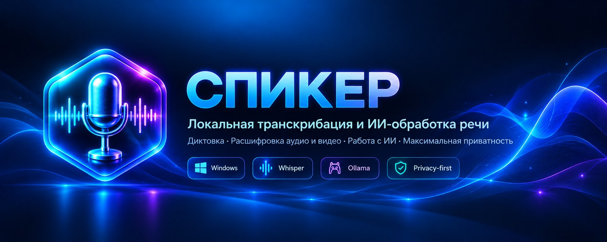
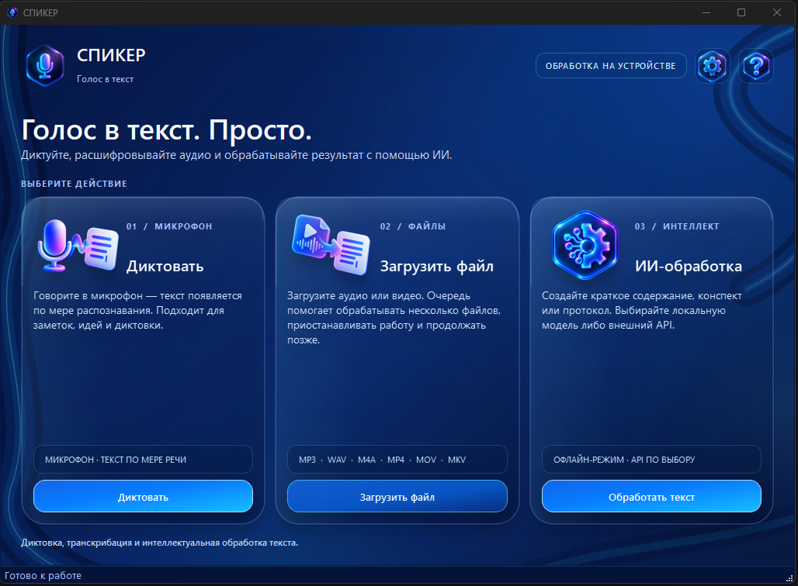
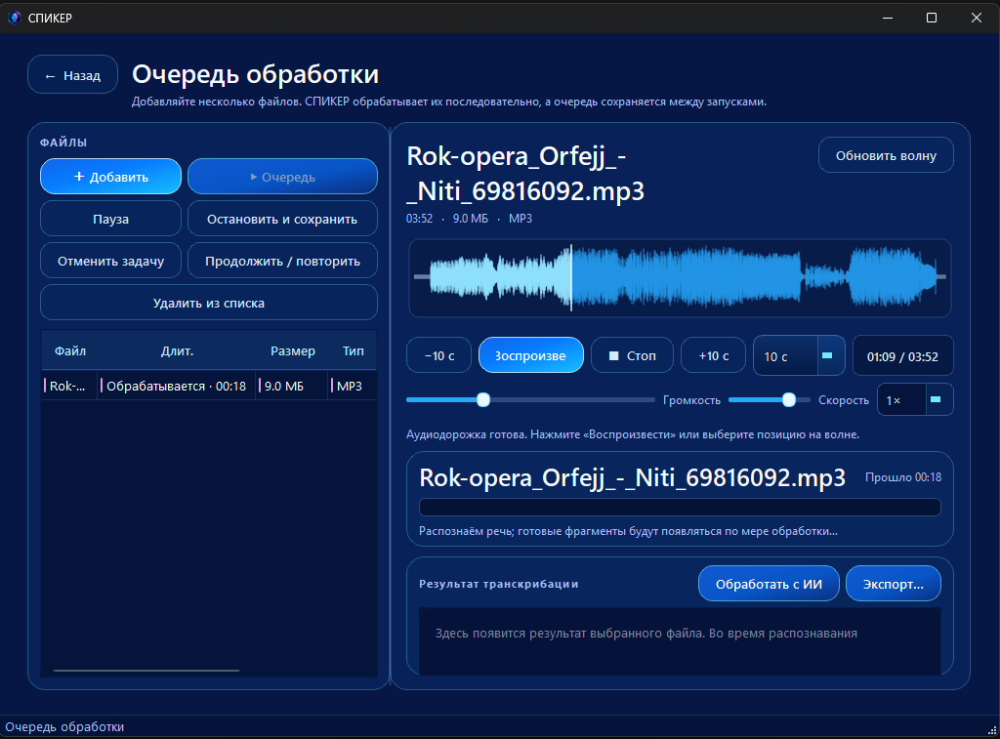
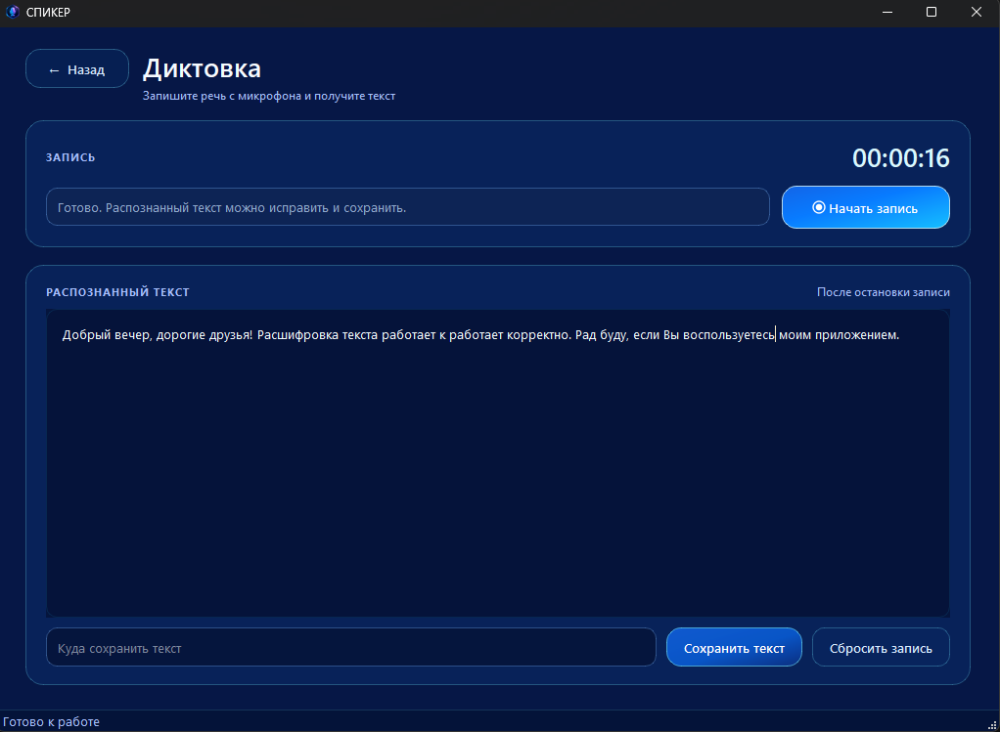
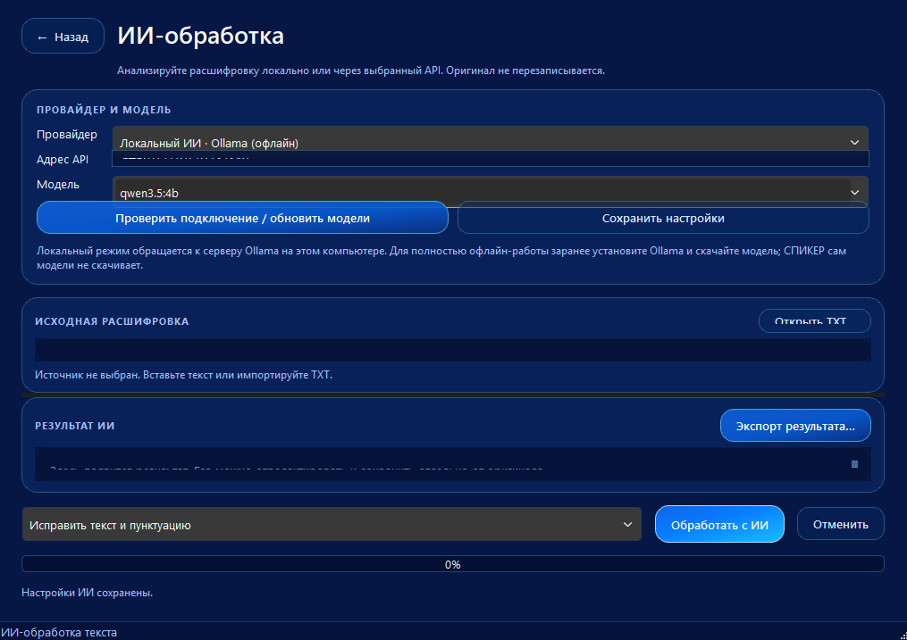
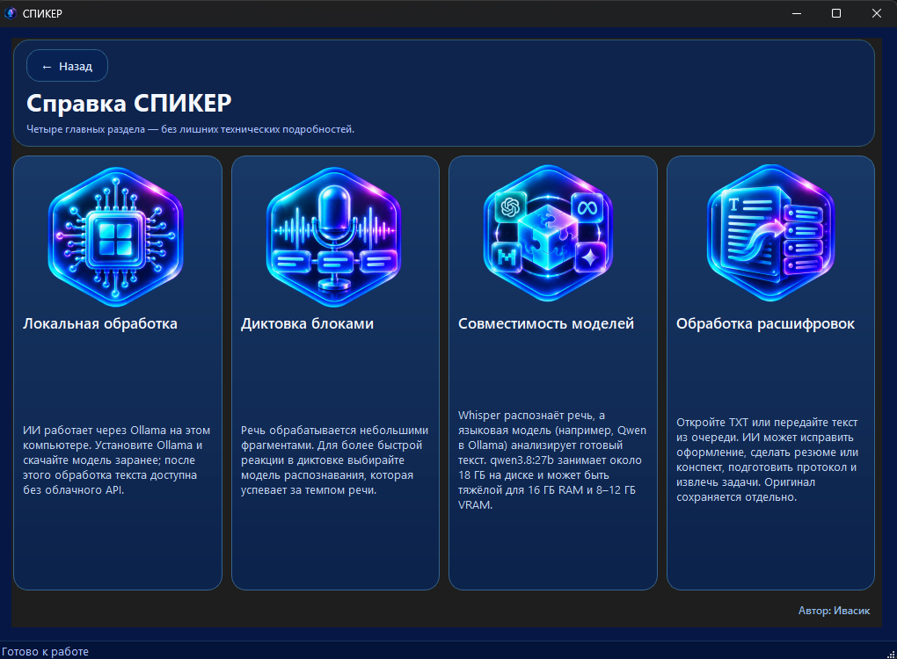

<div align="center">

       СПИКЕР — локальная транскрибация и ИИ-обработка речи
  <p><a href="README_EN.md">English version</a></p>
</div>

<div align="center">

# СПИКЕР — голос в текст. Просто.

**Настольное приложение для диктовки, транскрибации аудио и видео и интеллектуальной обработки текста.**

«Хорошая расшифровка — не конец работы с записью, а начало работы с её содержанием».

[Установка для Windows](#установка) · [Скриншоты](#скриншоты) · [Конфиденциальность](docs/PRIVACY.md) · [Сообщить об ошибке](../../issues)

</div>

---

## О проекте

**СПИКЕР** — настольное приложение для Windows, объединяющее диктовку с микрофона, распознавание речи из аудио- и видеофайлов, воспроизведение записей и ИИ-обработку готовых расшифровок.

Приложение предназначено для тех, кто регулярно работает с речевой информацией: специалистам, исследователям, преподавателям, студентам, авторам и всем, кому необходимо быстро переводить речь в текст и структурировать полученные материалы.

Основной принцип проекта — предоставить пользователю единое рабочее пространство для обработки речи, сохраняя контроль над файлами, результатами и способом обработки данных.

## Возможности

### Диктовка

Преобразование речи с микрофона в текст. Полученный материал можно проверить, отредактировать и сохранить в файл. Функция подходит для создания заметок, фиксации идей, подготовки черновиков и повседневной работы с текстом.

### Транскрибация аудио и видео

Распознавание речи из медиафайлов с помощью локальной модели Whisper. Можно добавлять несколько файлов в очередь и обрабатывать их последовательно.

Работа с очередью предусматривает управление задачами, приостановку обработки и возможность продолжить её позднее в поддерживаемых сценариях.

### Аудиоплеер и проверка расшифровок

Встроенный проигрыватель позволяет прослушивать исходную запись и перемещаться по звуковой дорожке. Это упрощает проверку распознанного текста, поиск нужных фрагментов и работу с длинными записями.

### ИИ-обработка текста

Готовые расшифровки можно преобразовывать в структурированные материалы. Доступные сценарии обработки включают:

- краткое содержание;
- подробный конспект;
- протокол встречи;
- извлечение задач и поручений;
- ответы на вопросы по тексту;
- редактирование и улучшение оформления;
- обработку по пользовательской инструкции.

Для обработки можно использовать локальную языковую модель через Ollama либо поддерживаемого внешнего API-провайдера.

### Работа с текстовыми форматами

Приложение поддерживает импорт исходного текста и экспорт результатов в распространённые форматы, включая TXT, Markdown, SRT, VTT, JSON и DOCX. Возможности экспорта зависят от типа результата и соответствующего сценария работы.

### Контроль над данными

Распознавание речи выполняется локально. Для ИИ-обработки можно использовать локальную языковую модель, если Ollama и нужная модель установлены и приложение настроено на локальный режим.

При выборе внешнего API текст передаётся соответствующему провайдеру. Перед отправкой следует учитывать конфиденциальность исходных материалов и условия обработки данных выбранного сервиса.

«Ваши данные заслуживают не только удобной обработки, но и осознанного выбора способа работы с ними».

## Скриншоты

Скриншоты демонстрируют основные разделы интерфейса СПИКЕР.

### Главное меню



### Очередь транскрибации и аудиоплеер



### Диктовка с микрофона



### ИИ-обработка расшифровок



### Справка и совместимость моделей


## Установка

### Windows 10/11 x64

1. Откройте раздел [Releases](../../releases) этого репозитория.
2. Скачайте установщик `Spiker-Setup-<версия>.exe`, если он опубликован.
3. Запустите файл и следуйте инструкциям установщика.
4. После установки приложение готово к локальной транскрибации с использованием включённой модели Whisper Small.

В штатную Windows-сборку входят необходимые компоненты приложения, включая Python-зависимости, Qt, FFmpeg и модель Whisper Small. Отдельная установка Python и Qt конечному пользователю не требуется.

Для распознавания речи после установки интернет не нужен, если все необходимые компоненты доступны локально.

**Обратите внимание:** если в разделе Releases отсутствует файл `Spiker-Setup-*.exe`, установщик ещё не опубликован. Порядок подготовки и публикации сборки описан в [инструкции по выпуску релизов](docs/PUBLISHING.md).

### Локальная ИИ-обработка

Для работы с локальной языковой моделью требуется [Ollama для Windows](https://ollama.com/download) и предварительно загруженная модель.

Например, модель можно загрузить командой в PowerShell:

```powershell
ollama pull qwen3.5:4b
```

После загрузки модели локальная ИИ-обработка может выполняться без подключения к интернету, если Ollama, модель и настройки приложения обеспечивают полностью локальный режим.

Языковые модели не входят в основной установщик: они могут занимать значительный объём дискового пространства и предъявлять высокие требования к оперативной памяти и видеопамяти.

Модель `qwen3.8:27b` доступна для выбора в приложении. Её размер составляет около 18 ГБ на диске; для устройств с 16 ГБ оперативной памяти и 8–12 ГБ видеопамяти она может оказаться непрактичной. Перед загрузкой рекомендуется оценить характеристики компьютера и требования выбранной модели.

### Потоковая диктовка через Vosk

Для потоковой диктовки можно отдельно настроить движок Vosk и загрузить совместимую модель. Это дополнительный компонент: его доступность зависит от выбранной конфигурации приложения.

## Для кого предназначен СПИКЕР

**Профессиональная деятельность.** Транскрибация встреч, интервью, звонков, совещаний и рабочих обсуждений.

**Образование и исследования.** Расшифровка лекций, семинаров, интервью и исследовательских записей; подготовка конспектов и структурированных материалов.

**Создание контента.** Фиксация идей, подготовка черновиков, преобразование голосовых заметок в редактируемый текст.

**Повседневная работа.** Диктовка сообщений и документов, обработка личных записей и быстрый поиск информации в текстовых материалах.

## Технологии

| Компонент | Назначение |
|---|---|
| Python | Основной язык разработки |
| PySide6 / Qt | Графический интерфейс |
| Whisper / whisper.cpp | Распознавание речи |
| Vosk | Дополнительный движок потоковой диктовки |
| FFmpeg | Работа с аудио- и видеоформатами |
| Ollama | Подключение локальных языковых моделей |
| Windows 10/11 x64 | Целевая платформа |

## Конфиденциальность

СПИКЕР предусматривает локальную обработку речи и возможность использования локальной языковой модели для работы с текстом. При корректной настройке локального режима исходные материалы не требуется отправлять внешнему ИИ-провайдеру.

Использование внешнего API предполагает передачу выбранного текста стороннему сервису. Пользователь должен самостоятельно проверить настройки подключения, политику конфиденциальности провайдера и допустимость передачи конкретных материалов.

Подробнее: [политика конфиденциальности](docs/PRIVACY.md).

## Разработка и сборка

СПИКЕР разработан на Python с использованием PySide6 и Qt.

Инструкции для разработчиков:

- [Сборка для Windows](docs/BUILD_WINDOWS.md)
- [Публикация релизов](docs/PUBLISHING.md)
- [Документация проекта](docs/)

Для локальной сборки требуется Python 3.11 x64. Команда ниже запускает подготовку Windows-сборки с установщиком:

```powershell
.\build_windows.ps1 -Installer
```

Для создания установщика локально требуется Inno Setup 6. В CI-сценарии сборка выполняется на Windows runner; фактическое наличие установщика в доступных для скачивания релизах следует проверять в разделе Releases.

Сборка включает библиотеки приложения, FFmpeg и модель Whisper Small. Ollama и веса языковых моделей для ИИ-обработки устанавливаются отдельно.

## Участие в проекте

Сообщения об ошибках, предложения по улучшению и идеи новых возможностей приветствуются.

Перед созданием обращения рекомендуется ознакомиться с [документацией](docs/) и выбрать подходящий [шаблон issue](../../issues/new/choose).

При описании ошибки по возможности укажите версию приложения, версию Windows, последовательность действий для воспроизведения проблемы и соответствующие сообщения из журнала приложения. Не прикладывайте конфиденциальные записи и тексты без необходимости.

## Лицензия

Исходный код СПИКЕР распространяется на условиях [Apache License 2.0](LICENSE).

Модели, библиотеки и другие сторонние компоненты могут распространяться на собственных условиях. Информация об источнике модели Whisper Small приведена в файле `models/whisper/MODEL_SOURCE.md` и материалах соответствующего релиза.

---

<div align="center">

**СПИКЕР**

*От речи к тексту. От текста — к результату.*

</div>
