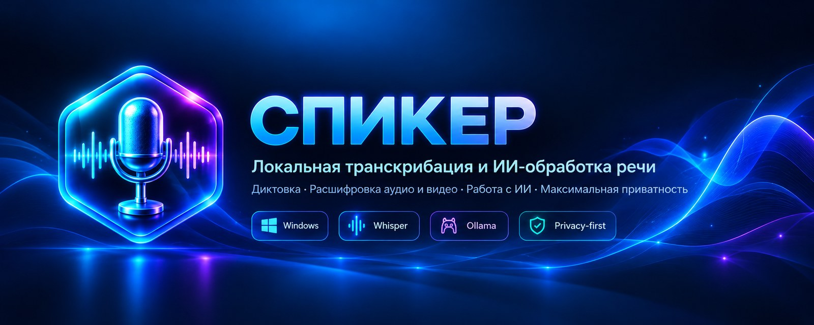
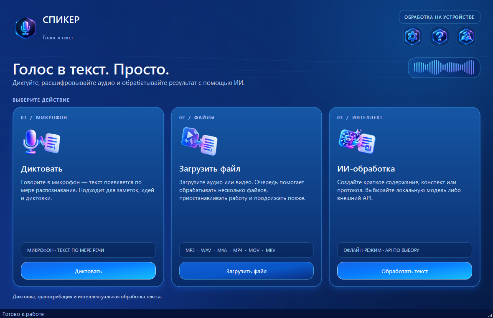
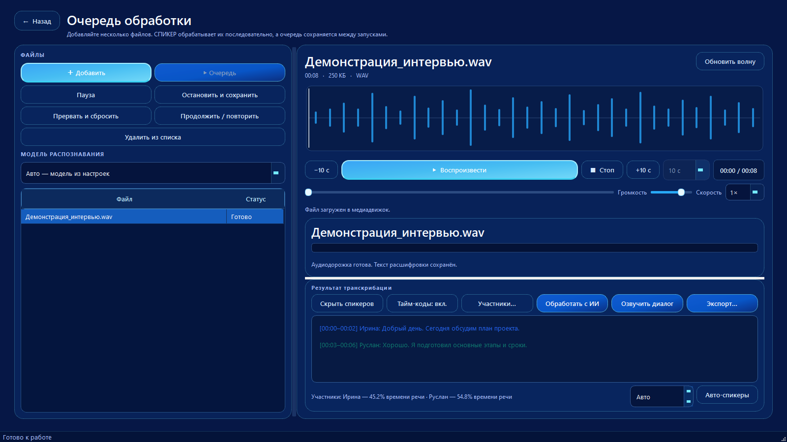
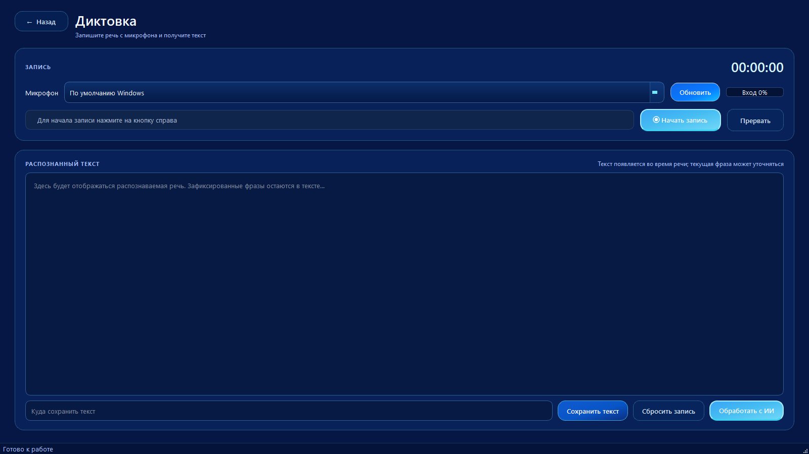
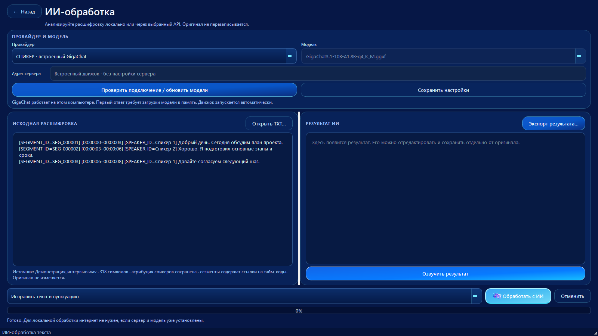
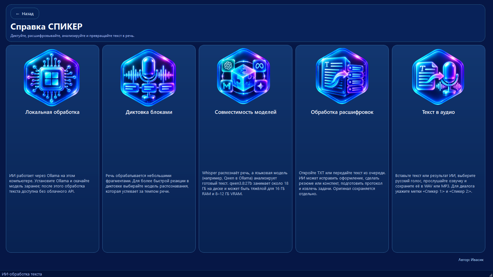

<div align="center">

  
  <p><a href="README.md">Русская версия</a></p>
</div>

<div align="center">

# SPIKER — speech to text. Simply.

**Speak, record, transcribe — SPIKER helps make the rest easier.**

A Windows desktop app for dictation, audio/video transcription, playback, and AI-assisted text processing.

[Download for Windows](#installation) · [Screenshots](#screenshots) · [Privacy](docs/PRIVACY.md) · Report bugs in this repository’s Issues section

</div>

SPIKER brings several workflows together: capture an idea, transcribe a long recording, listen to a specific part, and turn the transcript into a summary, notes, or meeting minutes.

**Less busywork — more time for what matters.**

### 3.1.3 — compact dashboard and navigation refresh

- The home dashboard compacts at shorter window heights and starts sized to the available desktop area, removing its vertical scrollbar.
- Main navigation buttons use a brighter blue-cyan shade for stronger contrast.
- Release 3.1.0 added local Russian text-to-speech, Whisper Medium, speaker diarization, and WAV/MP3 export.

### 3.1.1 — responsive layout and speech cleanup

- The home screen and transcription queue reflow at smaller window sizes.
- New transparent neon speech icons are used on the home screen and in Help.
- Markdown formatting is removed before text-to-speech so emphasis markers are not read aloud.
- File model selection shows faster-whisper Small and Medium; Whisper.cpp Small remains the automatic GGML fallback.

### 3.1.0 — stabilization and GitHub release build

- SQLite/WAL queue storage with legacy JSON import, per-task update hashes, and source-media fingerprint checks.
- Incremental transcript rendering to preserve the reader's scroll position as new segments arrive.
- Audio profiles for speech, meetings, music/singing, and preserving original audio; selectable audio stream for multi-track media.
- Safer speaker assignment: no nearest-speaker guess without sufficient temporal overlap; word-level timestamps can split a segment at speaker changes; overlapping candidates are preserved.
- pyannote Community-1 installation is checked end-to-end with `pyannote.audio==4.0.7`; the gated model still requires the user's Hugging Face acceptance and Read token.
- Structured meeting minutes include stable source segment IDs and timestamps; unknown segment/speaker references are rejected.
- GitHub Actions and the Windows build scripts create two Setup and Portable profiles: Full bundles Whisper Small, faster-whisper Small, Sherpa/T-one, and Vosk Small; Basic bundles Whisper Small without the extra engine models.

The gated pyannote model, Ollama, and LLM weights are installed separately. The source repository excludes model weights; Windows release packages include the models listed above. See `docs/BUILD_WINDOWS.md`, `docs/MODELS.md`, and `docs/ARCHITECTURE_AND_ROADMAP_3.1.0.md`.

### Interface and control fixes (3.0.7.4–3.1.0)

- The queue table keeps file name and status visible; metadata remains available in the selected-file panel and tooltip.
- Transcript segments appear in the editor as decoding progresses.
- Forced cancel/reset now stops capture and the decoder; normal stop drains recorded audio.
- Speaker profiles can be created and assigned manually without AI, even when pyannote is unavailable.
- Hardware diagnostics apply and persist recommendations; the UI reports the effective local engines and model compatibility.
- A separate in-app user guide is available from the home screen.

Manual regression plan: `docs/TEST_PLAN_3.1.0.md`.

### Advanced local transcription (3.1.0)

Settings include CPU/RAM/NVIDIA/CUDA diagnostics and a suggested profile, with manual CPU/CUDA, compute type, model, and batch overrides. An optional faster-whisper/CTranslate2 backend is available while Whisper.cpp remains the fallback. VAD, context hints, word timestamps (faster-whisper), optional loudness normalization, and optional pyannote diarization are supported. Speaker labels can be hidden without deleting speaker metadata; profiles can be renamed, merged, and individual segments reassigned. See `docs/ADVANCED_TRANSCRIPTION.md` before installing optional components.


## Features

- **Real-time dictation:** optional Sherpa-ONNX / T-one streaming recognition shows a changing hypothesis while you speak and commits phrases after pauses; Vosk remains a streaming fallback and Whisper remains available for short-window dictation. Install T-one with `Install_Live_Dictation.bat` and see `docs/LIVE_DICTATION.md`.
- **Audio/video transcription:** process multiple files in a persistent queue, pause tasks, and resume later.
- **Audio player:** listen to recordings and navigate the waveform to check long transcripts.
- **AI text processing:** create summaries and notes, structure information, extract action items, and improve formatting.
- **Local and API providers:** use local language models through Ollama or configure a supported external API.
- **Privacy-focused workflows:** speech transcription runs locally; local language-model processing stays on the device when Ollama is configured locally. External API requests send text to the selected provider.

## Screenshots

### Main menu



### Transcription queue and player



### Dictation



### AI text processing



### Help and model compatibility



## Installation

1. Open the repository's **Releases** page.
2. Download the Setup and matching model archives. Full uses `Spiker-Models-<version>.zip` plus `Spiker-Models-Medium-<version>.zip`; Basic uses one `Spiker-Models-<version>-Basic.zip`. Keep the files together.
3. Run Setup. It automatically unpacks the models. Python, Qt, and the application's runtime libraries are bundled.
4. For Portable, also download the matching model ZIP and place it beside the extracted `Spiker` folder. The app unpacks the models on first launch. The gated pyannote Community-1 model remains separate and requires accepting its Hugging Face terms.

If `Spiker-Setup-*.exe` is not shown in Releases yet, the Windows build has not been published. See [release publishing instructions](docs/PUBLISHING.md).

### Local AI text processing

Install [Ollama for Windows](https://ollama.com/download) and download a language model before going offline, for example:

```powershell
ollama pull qwen2.5:0.5b
```

In Spiker, select “Local AI · Ollama” and click “Check connection / refresh models.” The model is about 400 MB. See [the short Windows installation guide](INSTALL_WINDOWS_RU.txt).

Large language models are not included in the base installer because of their size. An external API is optional and requires internet access.

## Technology

Python · PySide6/Qt · Whisper/whisper.cpp · optional Sherpa-ONNX/T-one and Vosk · Ollama · Windows 10/11 x64.

## Development

See [Windows build instructions](docs/BUILD_WINDOWS.md) and [publishing guide](docs/PUBLISHING.md). The local release build uses Python 3.11 x64:

```powershell
.\build_windows.ps1 -Installer
```

The Full Windows release build bundles the application libraries, FFmpeg, Whisper Small, faster-whisper/CTranslate2 Small, Sherpa/T-one, and Vosk Small. Basic bundles Whisper Small; the extra engine models can be installed later. The pyannote Community-1 model, Ollama, and LLM weights remain separate. See `docs/PUBLISHING.md`.

## Contributing

Bug reports and feature ideas are welcome. Please check the [documentation](docs/) and use the relevant [issue template](.github/ISSUE_TEMPLATE/).

## License

Source code: [Apache License 2.0](LICENSE). Third-party components and model files may have separate licensing terms; see `models/whisper/MODEL_SOURCE.md` and release notes.

*SPIKER — your words, turned into ready-to-use text.*

### Windows build reliability fix (3.1.0)

The Windows builder installs the test-only Pillow dependency and repairs pip if ensurepip fails.


## Android

A Kotlin starter app for offline Russian dictation, voice separation, and speech synthesis is in `android/`. Setup instructions are in `docs/ANDROID_BUILD_RU.md`.
