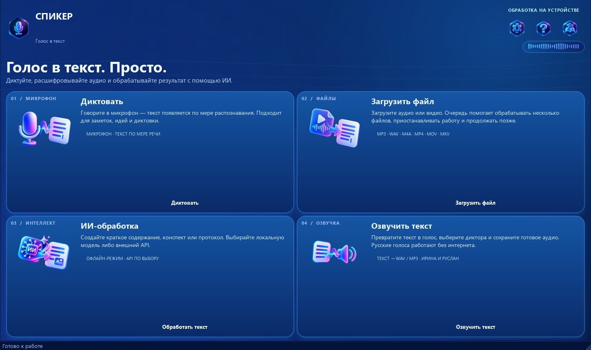
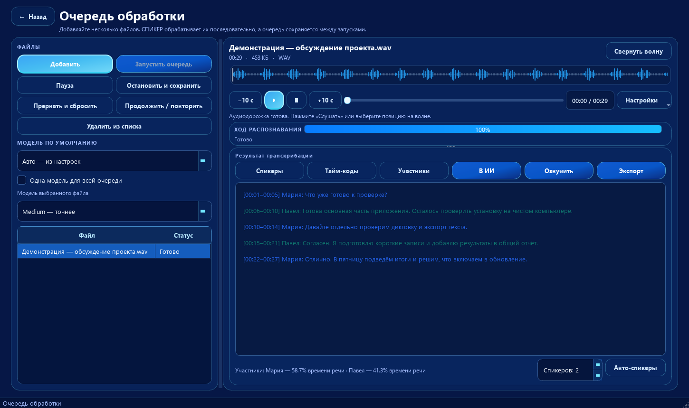
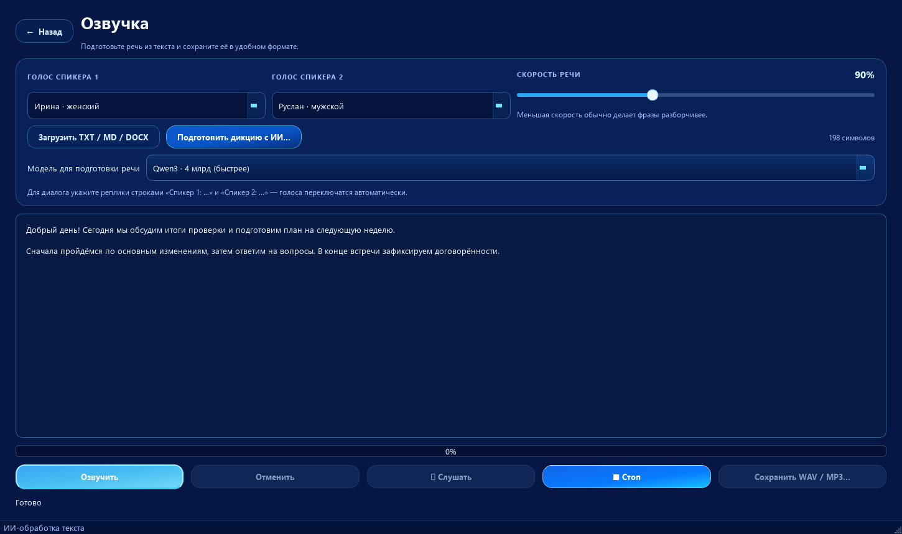
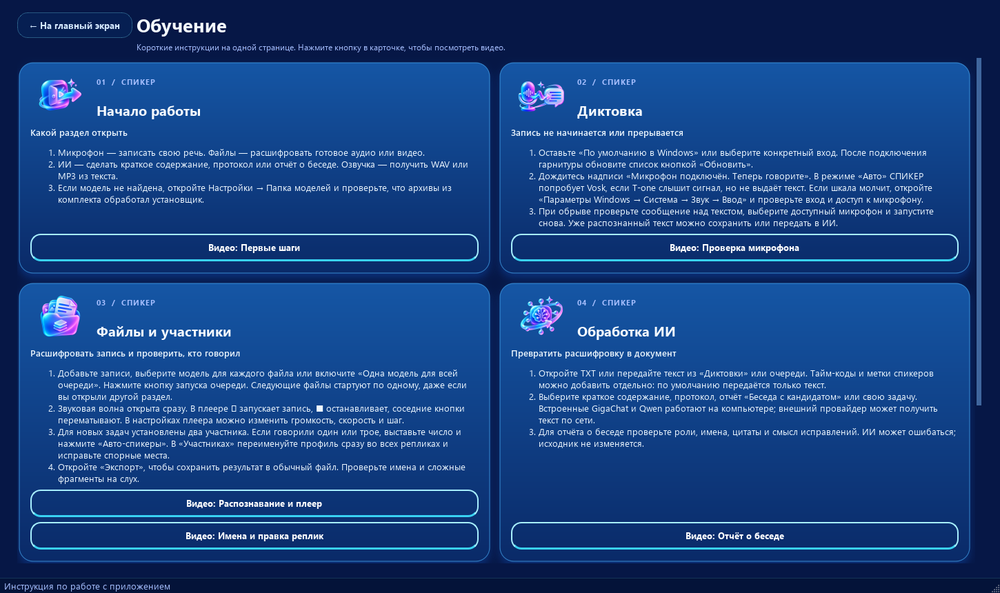

# Spiker 3.1.4 Refresh

[Download for Windows](https://github.com/MarcoPolo54321/Spiker/releases/tag/v3.1.4-refresh) · [Русская версия](README.md)

Spiker is a Windows desktop app for live dictation, audio and video transcription, editing speaker labels, text-to-speech and AI-assisted editing. When local models are selected, audio and text are processed on the device.

1. Download [Windows Setup](https://github.com/MarcoPolo54321/Spiker/releases/download/v3.1.4-refresh/Spiker-Setup-3.1.4-Windows.exe) and the [speech recognition ZIP](https://github.com/MarcoPolo54321/Spiker/releases/download/v3.1.4-refresh/Spiker-Models-3.1.4-Windows.zip).
2. Keep both files together and run Setup. Setup verifies and extracts the model archive.
3. Start Spiker. See the [model installation guide](README.md#дополнительные-модели) for optional voices, speaker diarization and local AI models.

This refresh fixes extra windows on the first visit to the file queue, improves microphone startup, lets you choose an ASR model per file, and makes AI input plain text by default, with optional speaker labels and timestamps. The queue starts manually and continues automatically. Tutorials include full-screen videos. New transcripts are saved without app-level encryption in `Documents/Spiker`.

| Home | File queue |
| --- | --- |
|  |  |
| **Text-to-speech** | **Tutorials** |
|  |  |

[All screenshots](README.md#скриншоты) · [Release history](RELEASE_NOTES.md) · [Windows build](docs/BUILD_WINDOWS.md) · [Privacy](docs/PRIVACY.md)
